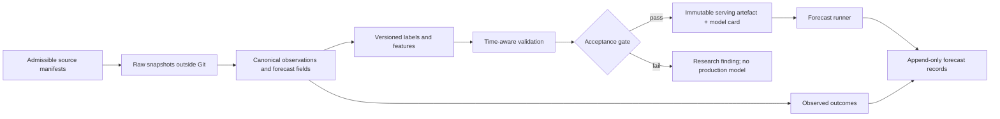
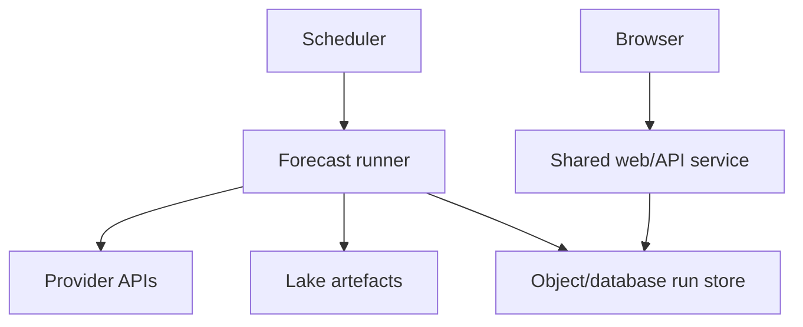

# Thermal-wind platform architecture

Status: proposed architecture, 26 July 2026.

## Decision

Build the platform as an open-source **modular monolith** with explicit
contracts between:

1. source adapters;
2. canonical meteorological data;
3. lake-specific outcome and feature definitions;
4. shared experiment, evaluation and artefact tooling;
5. lake-specific forecast pipelines; and
6. a shared web/API shell.

Do not turn Garda into the platform by progressively adding conditionals.
Do not begin with microservices. Extract a small platform kernel into a new
repository only after its contracts have been proven by one Garda regime and
one materially different second lake.

The platform standardises the boring and safety-critical parts—data access,
time handling, provenance, evaluation, artefacts and API shapes—while leaving
the meteorology local. A lake module may use logistic regression, a rule
system, multiple regime models or another explainable method without pretending
that every thermal wind is the same phenomenon.

## Why this boundary

Garda and Walchensee already demonstrate two legitimate product shapes:

| Concern | Garda | Walchensee | Platform consequence |
|---|---|---|---|
| Forecast execution | On demand, cached in the web process | Scheduled jobs writing durable runs | Support both request-time and scheduled pipelines |
| Forecast method | Two calibrated logistic models | Rules plus shadow ML models | Define a forecast contract, not one model base class |
| Ground truth | Fixed windows from an open public station | Intraday curve and backfill from a private partner station | Make labels replaceable and attach provenance to them |
| State | No durable forecast database | Stored run records with later ground-truth merge | Storage is a port, not a platform requirement |
| Product | Ora and Peler probabilities | Aggregate verdict plus rule explanations | A lake can expose one or several named regimes |
| Runtime | Pure-Python frozen coefficients | Rules and optional distilled/black-box shadows | Keep research dependencies out of serving by default |

The useful commonality is therefore not a universal thermal-wind algorithm.
It is a reproducible path from legally usable observations and forecast fields
to an honest, versioned lake forecast.

## Architectural principles

### Open-data core

Every source used by a public lake must pass an explicit admissibility check:

- access is repeatable without a person's private account;
- automated retrieval is allowed;
- the intended use and derived outputs are allowed;
- attribution requirements are known;
- the code, configuration, evaluation and derived model artefact can remain
  public; and
- any restriction on raw-data redistribution is enforceable separately from
  source-code publication.

Public access alone is not enough. A source with unclear or revocable
publication conditions may be explored in a private sandbox, but it cannot
become a dependency of the open platform release.

### Local meteorology is a first-class module

Names such as Ora, Peler, Maloja, Breva and Tivano are domain concepts, not UI
aliases for one generic classifier. Each regime owns:

- its riding area and representative observation sites;
- season and local-time windows;
- valid wind sectors and strength/duration thresholds;
- label logic;
- feature recipe;
- forecast horizon;
- model or rule implementation;
- calibration and abstention policy; and
- human explanations and translations.

The shared platform validates and runs these definitions. It does not invent
them.

### Reproducibility before cleverness

Training and serving must use the same feature implementation. Model artefacts
are immutable, versioned bundles with enough metadata to reconstruct the
experiment. A forecast record points to the exact artefact and source
snapshots used.

### Graceful incompleteness

Weather feeds fail. The result must distinguish:

- a confident negative forecast;
- a deliberately uncertain or `UNKNOWN` forecast; and
- a forecast that could not be produced because required inputs were absent.

Missing data must never silently become calm wind or a median value unless the
specific model bundle declares and tests that policy.

## Proposed repository shape

The target repository should look approximately like this:

```text
thermal-wind/
├── pyproject.toml
├── src/thermal_wind/
│   ├── core/
│   │   ├── observations.py
│   │   ├── forecasts.py
│   │   ├── provenance.py
│   │   ├── time.py
│   │   └── validation.py
│   ├── providers/
│   │   ├── meteoswiss.py
│   │   ├── geosphere.py
│   │   ├── meteo_france.py
│   │   ├── south_tyrol.py
│   │   ├── arpa_lombardia.py
│   │   └── open_meteo.py
│   ├── research/
│   │   ├── labels.py
│   │   ├── datasets.py
│   │   ├── evaluation.py
│   │   └── artefacts.py
│   ├── lakes/
│   │   ├── garda/
│   │   ├── silvaplana/
│   │   └── ...
│   ├── runtime/
│   │   ├── runner.py
│   │   ├── storage.py
│   │   └── scheduler.py
│   └── web/
│       ├── api.py
│       ├── site.py
│       └── templates/
├── lakepacks/
│   ├── garda/
│   │   ├── lake.toml
│   │   ├── sources.toml
│   │   ├── regimes/
│   │   └── artefacts/
│   └── silvaplana/
├── scripts/
├── tests/
└── docs/
```

`src/thermal_wind/lakes/` contains executable lake logic. `lakepacks/`
contains reviewable configuration, source manifests and small serving
artefacts. Raw observations, reanalysis and large fitted objects stay outside
Git.

This remains one installable Python project initially. Packages may be split
later if independent release cadence or third-party lake modules make that
worthwhile.

## Core contracts

The contracts should use ordinary typed Python structures and serialisable
representations. They should not expose pandas dataframes at module
boundaries.

### Observation

```python
Observation(
    source_id="meteoswiss",
    station_id="SIA",
    parameter="wind_speed",
    observed_at="2026-07-26T14:00:00+02:00",
    value=7.2,
    unit="m/s",
    interval="PT1H",
    quality="validated",
    retrieved_at="...",
    source_revision="...",
)
```

Required invariants:

- timestamps are timezone-aware;
- the original timestamp and timezone interpretation are traceable;
- units are canonical at the boundary (`m/s`, degrees clockwise from north,
  hPa, °C, mm and W/m²);
- direction is null when calm or undefined rather than fabricated as north;
- station and sensor moves remain visible as metadata; and
- quality flags are retained instead of being discarded during ingestion.

### Forecast field

A forecast value additionally identifies:

- model/provider;
- model run or initialization time;
- valid time;
- forecast lead time;
- grid point or station;
- parameter and level; and
- retrieval timestamp.

This prevents reanalysis, today's updated forecast and the forecast that was
actually available yesterday from being mixed accidentally.

### Regime definition

A lake exposes one or more regime implementations:

```python
class Regime(Protocol):
    identity: RegimeIdentity
    outcome_spec: OutcomeSpec
    feature_spec: FeatureSpec

    def build_features(self, inputs: InputBundle, day: date) -> FeatureVector: ...
    def label(self, observations: ObservationSeries, day: date) -> Outcome: ...
    def score(self, features: FeatureVector) -> RegimeForecast: ...
```

`OutcomeSpec` is declarative where possible, but `label()` remains executable.
This allows a simple fixed-window wind-sector label for Garda and a duration,
onset or multi-station label for another lake without growing an unusable
configuration language.

### Forecast result

Every regime returns a shared envelope:

```text
lake, regime, target date, issued at, valid window
probability or score
verdict: GO | MAYBE | NO_GO | UNKNOWN
confidence/calibration metadata
expected wind range and direction, when supported
top supporting and opposing factors
warnings and missing inputs
model artefact id
source snapshot ids
```

Lake-specific details may be added under a namespaced `details` block. The
common API must not discard them.

### Daily run record

A run record is append-only except for a separate outcome attachment:

```text
forecast run ── references ──> input snapshot + model artefact
     │
     └── later joined by identity ──> observed outcome
```

Backfilling truth must never rewrite what the platform claims it predicted at
the time. Re-scoring an old day with new code creates a hindcast with a new
identity, not a counterfeit historical forecast.

## Source adapters and provenance

Each provider adapter has four distinct responsibilities:

1. discover stations and parameters;
2. fetch immutable or time-bounded raw responses;
3. normalise them into canonical records; and
4. emit a provenance manifest.

The manifest should contain:

```toml
source_id = "meteoswiss"
dataset_id = "ch.meteoschweiz.ogd-smn"
licence = "CC-BY-4.0"
licence_url = "..."
attribution = "Federal Office of Meteorology and Climatology MeteoSwiss"
automated_access = true
raw_redistribution = true
derived_artefact_publication = true
terms_checked_on = "2026-07-26"
```

The fields are a project audit record, not a machine-generated legal
conclusion. Changes require review.

### Licence firewall

Sources receive one of three statuses:

- **public:** may feed public training and production;
- **evaluation-only:** may be examined but cannot produce a published model
  or public forecast;
- **prohibited:** must not be fetched, stored or used by platform tooling.

The dataset builder rejects mixed training data unless every included source
is `public`. Evaluation-only data cannot be converted into committed
coefficients. This is the architectural lesson from Walchensee: a private
station integration must be removable without making the platform or its
independent lake modules private.

Private deployments can provide separate adapters outside the public tree,
but their artefacts must use a separate namespace and must never be committed
to the open lakepack.

## Lakepack

A lakepack is the unit of review and deployment. It contains:

- stable lake and regime identifiers;
- display names and translations;
- riding areas and timezone;
- source/station selections and roles;
- local outcome definitions;
- feature and model entry points;
- latest approved serving artefacts;
- attribution text;
- model cards;
- station-fitness evidence; and
- production policy, including schedule and staleness limits.

Configuration should describe facts. Python should express meteorology. Avoid
putting complicated equations, fallback trees or rule programs into TOML.

Example:

```toml
[lake]
id = "silvaplana"
timezone = "Europe/Zurich"

[[regimes]]
id = "maloja"
implementation = "thermal_wind.lakes.silvaplana.maloja:Maloja"

[regimes.outcome]
station = "meteoswiss:SIA"
season = ["05-01", "09-30"]
window = ["12:00", "18:00"]

[production]
mode = "scheduled"
issue_times = ["07:00"]
max_input_age = "PT6H"
```

## Research and model lifecycle

The standard lifecycle is:



The evaluation harness should provide:

- leave-one-season/year-out validation;
- monthly or seasonal climatology baselines;
- calibration and threshold selection;
- confusion matrices and session-oriented metrics;
- forecast-input transfer tests, not only reanalysis performance;
- missing-data and source-outage simulation;
- station-move sensitivity;
- label-threshold sensitivity; and
- a final untouched time block where sufficient history exists.

There is no platform-wide accuracy threshold. Each model card declares the
decision criterion appropriate to the lake and compares it with a useful
baseline.

### Artefact format

Every serving artefact has:

- a content-derived identifier;
- lake and regime ids;
- code revision;
- training interval and cutoff;
- feature schema version;
- label schema version;
- source-manifest hashes;
- fitted parameters or a reference to them;
- calibration and verdict thresholds;
- missing-value policy;
- validation summary; and
- creation timestamp.

Simple models should be distilled to JSON or generated pure Python. More
complex models may use a pinned serialisation format, but the runtime
dependency and compatibility cost must be explicit.

## Runtime and deployment

Use one forecast runner with two execution modes:

- **request-time:** fetch, score and cache, suitable for Garda's current small
  service;
- **scheduled:** produce immutable run records ahead of use, suitable when
  history, monitoring or source latency matters.

The recommended production default for a multi-lake platform is scheduled
forecast generation plus a read-only web service:



This prevents visitor traffic from driving provider API load, preserves the
actual issued forecast and makes cross-lake monitoring straightforward.
Request-time mode remains useful for development and very small deployments.

Lake failures are isolated logically: an unavailable South Tyrol feed should
make Reschensee stale or unknown without blocking Silvaplana. A first
deployment may still run all lakes in one job; separate jobs are an operational
choice, not a code fork.

## Web product

The shared shell owns:

- lake discovery and routing;
- common verdict, probability, direction and time-window components;
- issued/stale/unknown state;
- history and model-quality views;
- attribution and source status;
- language negotiation;
- accessibility and responsive layout; and
- a stable JSON API.

The lake module supplies:

- regime vocabulary;
- descriptions of local physics;
- explanation labels and units;
- safety/context notes;
- launch-area context; and
- optional lake-specific panels.

Suggested routes:

```text
/                         platform/lake roster
/lakes/garda              lake landing page
/lakes/garda/ora          regime detail
/lakes/garda/history      issued forecasts and outcomes
/lakes/garda/model        model card
/api/v1/lakes
/api/v1/lakes/garda/forecasts/latest
/api/v1/lakes/garda/forecasts/{date}
```

No global "best lake today" ranking should be offered until probabilities and
outcome definitions are demonstrably comparable. Initially they are local
decision aids, not a common scale.

## What is shared and what is not

| Shared platform responsibility | Lake responsibility |
|---|---|
| Provider clients, retries and caching | Choice of relevant providers and locations |
| Canonical units and timezone handling | Meaningful local time windows |
| Provenance and licence gates | Outcome validity |
| Feature/label versioning | Feature recipe |
| Evaluation machinery | Baseline and acceptance criterion |
| Artefact envelope and registry | Model/rules and calibration |
| Run records and storage ports | Lake-specific details and explanations |
| Common API and UI components | Vocabulary, translations and rider context |

## Stress test against the first lakes

### Garda

- Two regimes under one lakepack.
- Existing shared feature builder becomes regime code.
- Frozen logistic parameters map cleanly to the artefact contract.
- Request-time serving can remain during migration.
- Meteotrentino and Open-Meteo manifests qualify for the public namespace.

### Walchensee

- Rules and shadow models are valid forecast implementations.
- Scheduled runs and later outcomes fit the run-record contract.
- The private Addicted-Sports station does **not** qualify for a public
  lakepack. It can live only in a private adapter/deployment namespace.
- An open Walchensee lakepack would need an independently open ground-truth
  source or must remain a research-only predictor without public validation
  claims.

### Silvaplana

- One initial Maloja regime.
- MeteoSwiss can provide both labels and auxiliary stations through one
  provider adapter.
- The lake is a good second implementation because its data licence is clean
  and its pipeline can be scheduled, unlike Garda's current request-time
  shape.

### Northern Maggiore and upper Como

- Both naturally want two named regimes with different windows.
- Maggiore proves that a lakepack can combine cross-border geography while
  retaining a Swiss outcome source.
- Como tests a provider whose historical delivery is less API-friendly; the
  adapter must make manual/email delivery visible and reproducible rather than
  hiding it behind a supposedly automatic interface.

### Achensee, Reschensee and Serre-Ponçon

- Achensee tests station relocations and composite identities.
- Reschensee tests high-frequency raw observations aggregated into canonical
  hourly outcomes.
- Serre-Ponçon tests large static archives and a station that may be
  meteorologically useful but not representative of the main riding basin.

None requires a new platform abstraction. They require different lake logic
and stronger station-fitness evidence.

## Repository migration

### Phase 0 — architecture and evidence

- Finish station-fitness reports for leading candidates.
- Select the second lake based on ground-truth quality, not popularity alone.
- Keep Garda production unchanged.

### Phase 1 — prove contracts inside Garda

- Introduce canonical forecast/result and provenance structures alongside the
  existing code.
- Wrap, rather than rewrite, Garda's feature builder and scorer.
- Add golden tests proving the wrapper does not change current probabilities
  or verdicts.

### Phase 2 — build the second lake

- Implement the provider adapter and lakepack against those contracts.
- Run the full fetch → label → train → artefact → forecast lifecycle.
- Record every awkward exception; change a shared contract only when both
  lakes benefit.

### Phase 3 — extract the platform

- Create the `thermal-wind` repository.
- Move the proven core, provider and evaluation modules with history where
  practical.
- Keep Garda's current repository deployable until output-parity tests pass.
- Migrate the public site only after the new service reproduces existing
  forecasts.

### Phase 4 — platform product

- Add the shared lake roster, API and operational monitoring.
- Add further lakes one at a time through a published acceptance checklist.

## Explicit non-decisions

The following should remain undecided until two lakepacks exist:

- SQL database versus object storage for run records;
- one deployment versus a job/service per lake;
- Python entry-point plugins versus modules in one distribution;
- a public third-party lakepack ecosystem;
- one shared frontend deployment versus lake-specific hostnames;
- probabilistic multi-class models versus independent regime models; and
- a global cross-lake session score.

Prematurely fixing these choices would add infrastructure without reducing the
main uncertainty: whether a station provides a valid, open outcome for its
lake.

## Acceptance checklist for a new public lake

A lake may be listed as a production forecast only when:

1. surf use and the target local regime are documented;
2. outcome station fitness is demonstrated;
3. every training and production source has a public manifest;
4. at least five usable seasons exist, with ten preferred;
5. the label definition is reviewed visually on positive and negative days;
6. the model beats an appropriate climatology or simple-rule baseline under
   time-aware validation;
7. performance survives a forecast-input transfer test;
8. failure, staleness and `UNKNOWN` behaviour are tested;
9. a model card and exact attribution are published; and
10. another developer can recreate the serving artefact without private
    credentials or private data.

If a lake fails the data or skill gate, it can remain visible in the research
roster. The platform should make negative results publishable rather than
pressuring every candidate into becoming a product.
